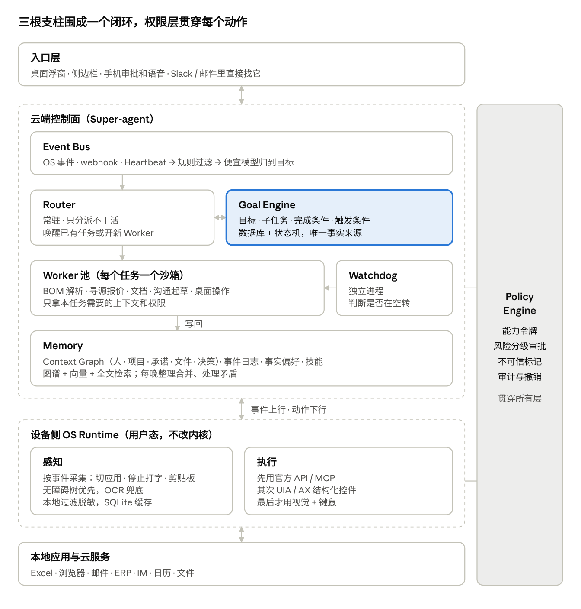

# Continuum（续）

常驻在操作系统里的 AI 幕僚长：看得到你此刻在做什么，记得过去发生了什么，并能替你长期负责一部分工作。

> 用户切换的是软件，AI 维护的是同一个连续的工作世界。

## 组成

- **Super-agent**：云端 Router + Worker + Watchdog，事件驱动，长期推进目标。
- **OS Runtime**：设备侧用户态服务，按事件感知屏幕与应用，在授权范围内执行操作。
- **Memory**：Personal Context Graph + 事件日志 + 事实偏好 + 技能。
- **Goal Engine**：把长期责任存在数据库和状态机里，模型不当事实来源。
- **Policy Engine**：能力令牌、风险分级审批、不可信标记、审计与撤销，贯穿所有层。



## 文档

- [项目大纲](docs/outline.md)：定位、要解决的问题、切入场景、目标、相似项目、架构、模块设计、技术选型、路线图、风险。
- [框架设计（草案）](docs/framework.md)：用 Python 复刻 dsh-superagent 的核心思想，内核小、扩展点多。

## 试一下

```bash
uv venv --python 3.12 .venv
uv pip install --python .venv/bin/python -e ".[dev]"

.venv/bin/continuum init                 # 在 ./.continuum 建一个 home，写默认设置
.venv/bin/continuum run                  # 在另一个终端里一直跑着
.venv/bin/continuum send "帮我检查这版 BOM 报价"   # 发一句话，等确认和结果
.venv/bin/continuum send "顺便核一下交期" --no-mention   # 同一话题追加，原工单自动恢复
.venv/bin/continuum status               # 看工单
.venv/bin/continuum log                  # 看所有回复
```

- 桌面端和其他客户端走 API（默认 `127.0.0.1:8170`）：`continuum user add <名字> --device <设备>` 发一个令牌（只显示一次），再把这个名字写进 `[policy.sources.app].allowed`。接口文档在运行时的 `/api/docs`。放到服务器上时，API 只监听本机，前面用 Caddy 之类的反向代理加 HTTPS。
- 谁能派活写在 `.continuum/continuum.toml` 的 `[policy.sources.cli].allowed`，默认是 `me`（`send --as` 的默认值）。
- 换 Worker：在 `.continuum/plugins/` 放一个定义了 `plugin = Plugin(name=..., scripts={...})` 的 `.py` 文件，再把 `[executor.config].script` 改成脚本名，不用改任何核心代码。
- 服务器部署：API 只监听本机，外面经 Caddy 转发（和 sekai、ATRI 一样在 Cloudflare 后面）。第一次运行 `sudo bash deploy/install-caddy.sh <域名>`，之后改 `/etc/caddy/continuum.caddy` 不用 sudo。
- 进程随时可以被杀掉；重启后，干到一半的工单会带着恢复说明重新开始，已经发出的消息不会再发。

## 开发

```bash
.venv/bin/python -m pytest -q
.venv/bin/ruff check src tests
```

## 状态

- F0 内核已完成：领域模型、Engine 五部分、Gate 规则链与标准 Gate、研判校验、策略变更影响。
- F1 运行时已完成：SQLite 存储、Effects 队列、Outbox、调度循环、插件注册表、进程内执行器、命令行 Source、规则版 Router、脚本 Worker、`continuum` 命令。
- F2a 远程 API 已完成：令牌登录、桌面对话 Source、HTTP 接口（对话、工单、叫停、重试）、WebSocket 实时推送。
- 下一步 F2b：Windows 桌面端（Electron）；F2c：接入模型做 Router 和 agent Worker（带沙箱）。

`core` 和 `policy` 移植自 dsh-superagent（MIT），见 [THIRD_PARTY_NOTICES.md](THIRD_PARTY_NOTICES.md)。
