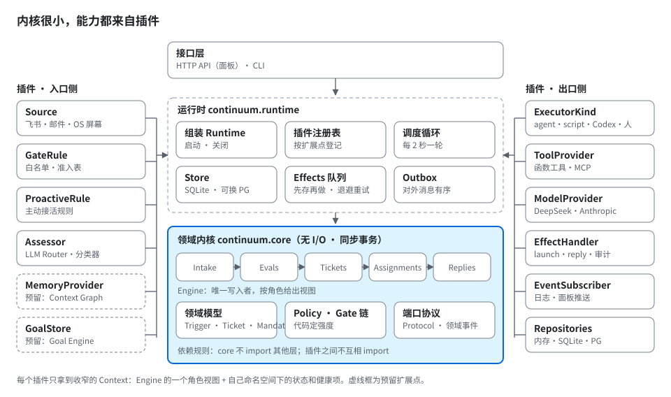
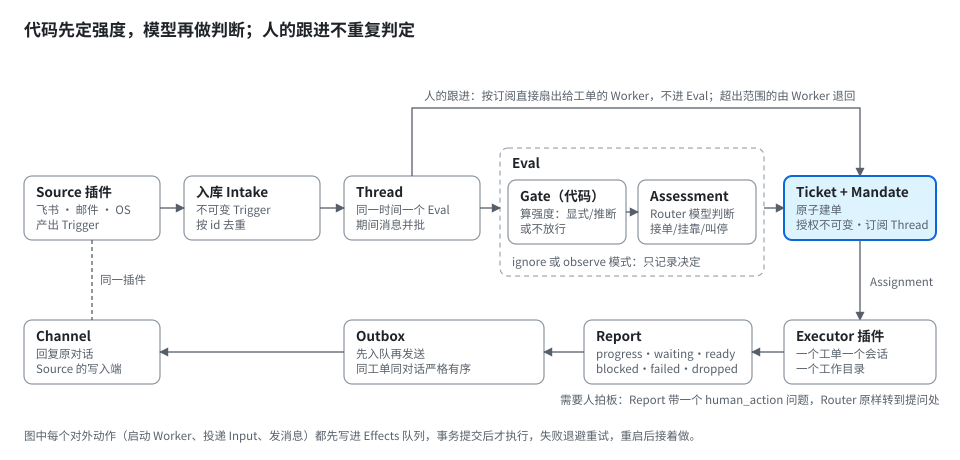
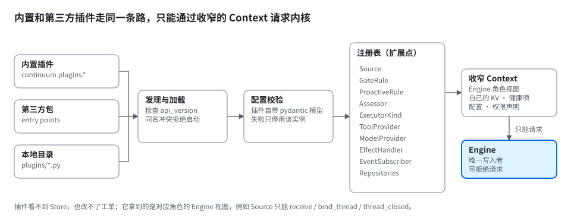

# Continuum 框架设计（草案）

2026-11-02 · 草案，待讨论

用 Python 复刻 [dsh-superagent](https://github.com/deepseek-ai/dsh-superagent) 的核心思想，并把它做成一个**内核很小、扩展点很多**的框架：内核只管"谁能让 agent 干活、干到什么程度、干的过程可靠可审计"，其余一切（事件从哪来、谁来干、用什么模型、结果发到哪）都是插件。

## 1. 设计原则

从 dsh-superagent 继承的六条：

1. **概念少**：只有 Source、Trigger、Thread、Eval、Mandate、Ticket、Assignment、Subscription、Channel、Policy 这几个领域概念。新需求要么是某个概念的属性，要么是一段提示词，不新增概念。
2. **内核纯净**：`continuum.core` 不做任何 I/O、不调模型、同步执行，只改领域状态。所以领域规则可以全内存测试。
3. **单一写入者**：工单、Thread、决策只有 Engine 能写；插件只能通过收窄的接口请求 Engine，不能直接改状态。
4. **先存再做**：所有副作用（启动 Worker、投递消息、对外回复）都在事务里入队，提交后才执行；失败重试，崩溃后接着做。
5. **代码定权限，模型做判断**：谁能要活、强度多大由代码（Gate）算；模型只在这个范围内判断接不接、怎么做。外部文本永远只是数据。
6. **尽量少占人的注意力**：有人要或有规则允许才动手，有结果或需要决策才开口。

为"包容"新增的三条：

7. **一切外部能力都是插件**，内置实现和第三方插件走同一套注册机制，没有"特权插件"。
8. **插件自描述**：每个插件声明自己的配置结构（pydantic）、健康项、所需权限；框架据此做校验、生成面板表单、做授权。
9. **契约有版本**：扩展点接口带 `api_version`，内核升级不悄悄破坏插件。

## 2. 分层



| 层 | 包 | 职责 | 依赖 |
| --- | --- | --- | --- |
| 领域内核 | `continuum.core` | 领域模型、Engine 及其五个部分、Policy 判定、端口协议（Protocol）、领域事件 | 只依赖标准库和 pydantic |
| 运行时 | `continuum.runtime` | 组装（composition root）、Store、Effects 队列、Outbox、调度循环、插件注册表、设置与提示词版本、会话管理 | core |
| 插件 | `continuum.plugins.*` 和第三方包 | 各扩展点的具体实现 | 只依赖 core 的协议和 runtime 给的 Context |
| 接口 | `continuum.interfaces` | HTTP API（面板用）、CLI | runtime |

依赖规则：`core` 不 import 任何其他层；插件之间不互相 import，只通过注册表协作。

## 3. 一条事件的旅程



1. **入库**：Source 插件把外部事件翻译成不可变的 `Trigger`，交给 `Engine.receive()`。同 id 重复到达直接返回 `duplicate`。
2. **扇出**：查 Trigger 所属 Thread 上订阅的工单，作为 `Input` 投过去。人发的消息若已被某工单认领，就交给那个工单的 Worker 自己判断，不进 Eval。
3. **Eval 第一层 Gate**：GateRule 插件链按顺序判定，得出强度 `explicit` / `inferred` / 不放行，以及依据（basis）。
4. **Eval 第二层 Assessment**：Assessor 插件（默认是 LLM 的 Router 会话）在强度范围内判 `accept` / `attach` / `stop` / `ignore`。推断候选要按启用的规则逐条判断并给证据；`observe` 模式下只记录"本来会接"。
5. **建单**：accept 在一个事务里建好 Ticket、Mandate、首个 Assignment、订阅，以及确认消息的发件记录。
6. **执行**：Effects 队列启动 Executor 插件，Worker 在自己的会话和工作目录里干活，用结构化 `Report`（progress / waiting / ready / blocked / failed / dropped）汇报；需要人拍板时带一个 `human_action` 问题。
7. **回复**：所有对外消息经 Outbox 入队，由对应 Source 的 Channel 发出，同一工单同一对话严格有序。

## 4. 扩展点



| 扩展点 | 协议 | 做什么 | 内置实现 | 以后的例子 |
| --- | --- | --- | --- | --- |
| Source | `SourceKind` | 产出 Trigger，划分 Thread；可选 Channel（写回）、上下文读取器、Policy 片段 | `cli`、`webhook`、`timer` | 飞书、邮件、GitHub、ERP、**OS Runtime**（屏幕事件） |
| Gate 规则 | `GateRule` | 对 Trigger 给出强度和依据，或弃权；按顺序组成链 | 白名单、准入表、机器人名单 | 部门规则、工作时间规则 |
| 主动规则 | `ProactiveRule` | 描述一类"没人点名也可以接"的活，给 Assessor 看 | 文本规则 | 报价异常规则、交期变更规则 |
| Assessor | `Assessor` | Eval 第二层判断 | LLM Router 会话、`always_ignore`（测试用） | 规则引擎、小模型分类器 |
| Executor | `ExecutorKind` | 运行一个 Assignment：准备工作区、开会话、投递 Input、回报 | `agent`（内置工具循环）、`script`（确定性 Python 函数）、`claude_code`（Claude Code CLI）、`codex`（OpenAI Codex CLI） | OManus、`human`（派给人） |
| 工具 | `ToolProvider` | 给 Worker 提供工具 | Python 函数工具、MCP 客户端 | BOM 解析、寻源、ERP 查询 |
| 模型 | `ModelProvider` | 统一的对话/工具调用接口 | OpenAI 兼容（覆盖 DeepSeek） | Anthropic、本地模型 |
| Effect 处理器 | `EffectHandler` | 一类持久副作用的执行器 | launch、delivery、relay、reply | 写审计、推送通知 |
| 事件订阅 | `EventSubscriber` | 订阅领域事件（`ticket.created` 等），只读，可再入队副作用 | 日志、指标 | 面板实时推送、Webhook 转发 |
| 存储 | `Repositories` | 领域仓库 + KV | 内存、SQLite | PostgreSQL |
| 预留 | `MemoryProvider`、`GoalStore` | Continuum 的记忆与长期目标 | — | Context Graph、Goal Engine |

### 插件长什么样

```python
# my_plugin/__init__.py
from continuum.plugin import Plugin, PluginContext
from pydantic import BaseModel

class EmailConfig(BaseModel):
    imap_host: str
    mailbox: str = "INBOX"

class EmailSource:                      # 实现 SourceKind 协议
    kind = "email"
    config_schema = EmailConfig
    async def run(self, ctx, config):   # ctx 是收窄的 SourceContext
        async for msg in poll(config):
            ctx.receive(to_trigger(msg))   # 只能"请求"Engine，不能直接写状态

plugin = Plugin(
    name="email",
    api_version="1",
    provides={"sources": [EmailSource()]},
    requires_permissions=["network"],
)
```

```toml
# 第三方包的 pyproject.toml，用标准 entry points 被发现
[project.entry-points."continuum.plugins"]
email = "my_plugin:plugin"
```

框架启动时：

1. 从 entry points 和本地 `plugins/` 目录发现插件，检查 `api_version`。
2. 把插件提供的实现登记到注册表的对应扩展点；同名冲突拒绝启动。
3. 每个插件只拿到对应角色的 Context（`SourceContext`、`ExecutorContext`……），里面是 Engine 的一个"角色视图"，加上它自己命名空间下的 KV 状态和健康项。
4. 配置用插件声明的 pydantic 模型校验；校验失败只停用这个插件实例，不影响别的。

## 5. 内核模型（复刻 dsh-superagent）

| 概念 | Python 类型 | 关键规则 |
| --- | --- | --- |
| Trigger | `Trigger(id, source, threads, actor, human, addressed, at, text, meta)`，frozen | 不可变；按 id 幂等 |
| Thread | `Thread(key, subscriptions, context_subs, running_eval, queued, correlated)` | 同一时间最多一个 Eval；期间到达的合并进下一批 |
| Eval / Decision | `Evaluation`、`Decision(outcome, reasons, strength)` | 无状态判决；过期重排两次，第三次记 `unavailable` |
| Mandate | `Mandate(policy_version, scope, strength, basis, rules, sender)`，frozen | 不可变；恢复前用当前 Policy 重新校验 |
| Ticket | `Ticket(id, mandate, channels, inputs, follows, ended)` | 只有 accept 能创建；人叫停后不再接收任何东西 |
| Assignment | `Assignment(id, executor, state, reports)` | pending → running → ended，与工单状态独立 |
| Report | `Report(state, summary, human_action, evidence)` | 六种状态；问题只走结构化字段 |

Engine 按职责拆成五部分，单向依赖：`Intake → Evals → Tickets → Assignments → Replies`。调用方拿到的是角色视图：`EngineForSources`、`EngineForRouter`、`EngineForExecutor`、`EngineForPeople`、`EngineForSettings`。

## 6. 技术选型

| 用途 | 选择 | 理由 |
| --- | --- | --- |
| 语言 | Python 3.12 | 团队栈；`typing.Protocol` 适合端口与适配器 |
| 领域模型与配置 | pydantic v2 | 校验、序列化、自动生成表单所需的 JSON Schema |
| 并发 | asyncio，单进程 | 内核同步、运行时异步；和 dsh 一样一个调度循环 |
| 存储 | SQLite（WAL）起步，仓库协议可换 PostgreSQL | 单写入者模型下 SQLite 足够 |
| 插件发现 | `importlib.metadata` entry points | 标准机制，不引入额外框架 |
| HTTP / CLI | FastAPI / Typer | 面板 API 和运维命令 |
| 测试 | pytest | 内核用内存仓库做纯领域测试 |

## 7. 复刻路线

| 阶段 | 内容 | 验收 |
| --- | --- | --- |
| F0 内核 | 领域模型、Engine 五部分、Policy 与 Gate 链、内存仓库 | 用纯内存测试覆盖：幂等、串行 Eval、扇出、跟进归属、handback、Mandate 重校验、observe 模式 |
| F1 运行时 | SQLite、Effects、Outbox、调度循环、插件注册表、`cli` Source、`script` Executor | 命令行发一条请求，脚本 Worker 完成并回复；中途杀进程重启后能接着做 |
| F2 智能 | `ModelProvider`、LLM Assessor（Router 会话）、`agent` Executor、提示词版本 | 一条自然语言请求被正确接单、执行、汇报；推断候选在 observe 模式只记录 |
| F3 接入 | `webhook`、`timer`、一个真实 IM 或邮件 Source；HTTP API 和最小面板 | 面板只显示等人处理的工单 |
| F4 Continuum | OS Runtime Source、`MemoryProvider`、`GoalStore` | 进入大纲里的 MVP |

## 8. 进度

**F0 已完成（2026-11-02）**：`src/continuum/core` 和 `src/continuum/policy`，50 个纯内存测试（`tests/`）。不基于 OManus，直接按 dsh-superagent 的内核用 Python 重写（2026-11-02 定）。

与 dsh-superagent 有意不同的地方：

- 去掉了它为兼容旧数据保留的分支（旧版 basis、旧版已读标记、旧队列清理等）。
- Gate 改成规则链：`RulePolicy` 依次问每条 `GateRule`，第一个不弃权的说了算；Mandate 记下是哪条规则放行的，以后由同一条规则重校验。`StandardGate` 是 dsh 原来的判定逻辑。
- 从没投递给 Worker 的消息，结束工单时一律算"未读"（原版在某些情况下算已读）。
- `WorkerReport` 用 `clear_question=True` 清除问题，代替原版的 `question: null`。
- 关闭结果、工单结局用字符串，不限定 GitHub 的 merged / closed，方便别的 Source 定义自己的结局。

**F1 已完成（2026-11-03）**：`src/continuum/runtime`、内置插件 `src/continuum/plugins`、`continuum` 命令。共 105 个测试，其中内核测试同时跑在内存仓库和 SQLite 上。手动验证过：用 `kill -9` 杀掉正在干活的进程，重启后工单带着恢复说明继续，已发出的消息不会再发。

F1 的取舍和已知限制（F2/F3 再处理）：

- Worker 和主程序在同一进程（方案 A）。执行器接口按"Worker 可能在别处"设计，以后换独立进程不用改内核。
- Effects 队列一次只跑一个任务。F1 的任务都很快，没有问题；F2 的 Router 要调模型，到时需要按种类并发。
- 还没有 dsh 里"给人的消息多留一个 Worker 槽位"的规则。
- 还不能从命令行叫停工单（`stop`）：叫停要通知正在运行的进程，需要 F3 的 HTTP API 或控制通道。
- 对外发送是"至少一次"：发出后、记账前崩溃，重启后会再发一次。命令行 Source 用消息 id 去重，所以不会重复；以后接飞书、邮件，也要靠消息 id 去重。
- Worker 失败时，单个工单的投递失败（`delivery_failed`）还没有用上：进程内投递不会失败。

**F2a 远程 API 已完成（2026-11-03）**：令牌登录（`continuum user add`），`app` Source 给每个用户自己的对话，HTTP 接口（对话、工单、叫停、重试），WebSocket 实时推送回复和工单变化。所有接口都在主事件循环里执行，不进线程池，因为 Engine 和 Store 不是线程安全的。

**F2b Windows 桌面端已完成（2026-11-03）**：`desktop/`，Electron。常驻小窗口，有对话页和工单页（等你处理的排最前），托盘、`Ctrl+Shift+Space`、系统通知。令牌只在主进程里，用系统加密保存。界面在无头浏览器里测，网络客户端用 Node 连真实服务器测，Electron 外壳和安装包由 Windows CI 跑。

## 9. 待定

- 单进程是否够用，还是一开始就把 Executor 放到独立进程/机器？
- 插件的权限声明（`requires_permissions`）由谁审批、怎么落地到沙箱？

## 用自己的 Claude / ChatGPT 账号当 Worker

`claude_code` 和 `codex` 两个执行器调用本机已登录的官方命令行（`claude -p`、`codex exec`），读它们的 JSON 事件流：命令、文件改动变成工单的步骤，回答边写边推给桌面端，最后一条回答就是汇报。以【问题】开头是向人提问，【卡住】【失败】【无需处理】对应其余几种汇报。工具自己的会话记在工作区旁边，人回复后下一轮接着这个会话。

```toml
[executor]
kind = "claude_code"        # 或 "codex"

[executor.config]
# model = "opus"            # 不写就用账号的默认模型
# allowed_domains = ["pypi.org", "files.pythonhosted.org"]   # claude_code：命令能访问的域名，默认不联网
# network = true            # codex：命令能否联网，默认否
# instructions = "团队的要求"
```

隔离有两层，都默认开启：
- 工具进程在 bubblewrap 里：系统只读，工作区可写，自己的登录状态可写；Continuum 的数据目录、`~/.config`、`~/.ssh`、云服务凭据、另一个工具的登录状态都看不到。进程本身要联网访问模型。
- 它执行的每条命令再由工具自己的沙箱隔离（Claude Code 的 sandbox 需要 `bubblewrap` 和 `socat`；Codex 用 workspace-write）。Claude Code 的沙箱起不来时，这一轮直接失败，不会退回无沙箱运行。

只用于你自己在自己的服务器上用：Anthropic 不允许第三方产品让别人用 claude.ai 账号登录，要给别人用就换成 API key。订阅有用量上限。

## 项目

人看到的只有项目；工单留在内核里，做执行单位（一次运行就是一张工单）。

- **一次性项目**：人提一件事，路由器接单，就是一个一次性项目（即这张工单）；做完自动归档，再提起时重新打开。
- **长期项目**：Worker 用 `propose_project` 提议（名字、目标、章程、定时安排），人在对话里确认后生效。章程是人给的长期授权：项目只能在章程内自己开工，超出的事回到人这里。
  - 定时安排有两种：`remind` 在主对话里发一条提醒；`run` 在项目自己的话题（`p-<id>`）里发一条“定时任务”，由路由器接单，开一次运行。
  - 项目的每次运行共用项目的工作区（`<home>/projects/<id>`）和笔记 `NOTES.md`；Worker 开工时带上目标、章程和笔记，结束前把下次该知道的写进笔记。每次运行的对话记录和工具会话仍各存各的。
  - 时间按人的时区（桌面端登录时上报）计算；可以暂停、继续、结束，也可以设到期日。
- **一条对话**：人只和主 agent 对话。项目的消息（包括提醒）都在这一条对话里，带着所属项目的标记；在项目里说话，只是这条消息直接交给那个项目。

接口：`GET /api/v1/messages`（全部消息，带 `project`）、`GET /api/v1/steps`、`GET /api/v1/projects`、`POST /api/v1/projects/{id}/confirm|refuse|pause|resume|end`、`PUT /api/v1/me/timezone`。
