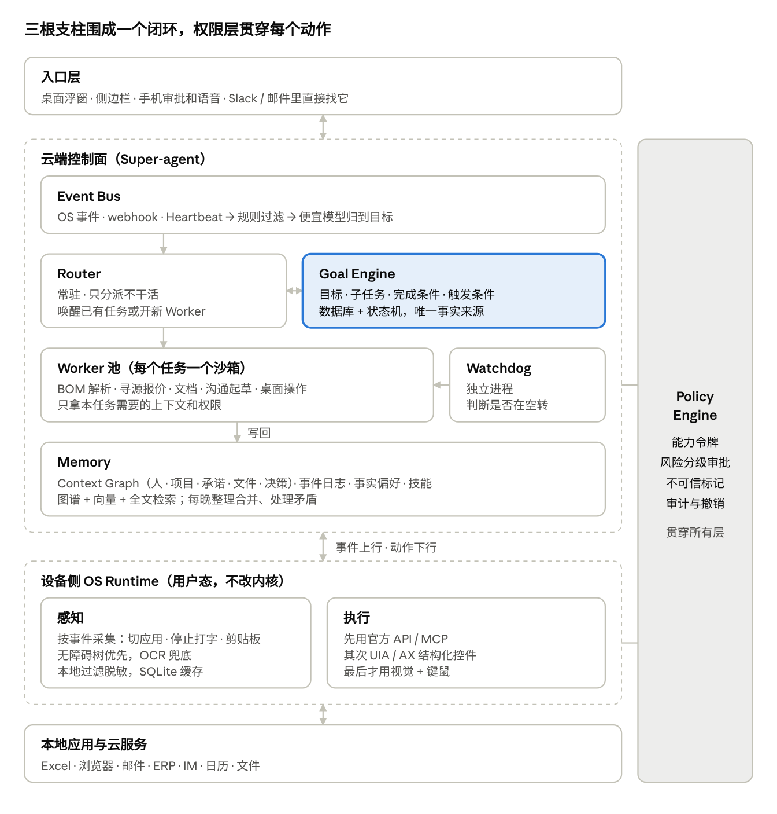
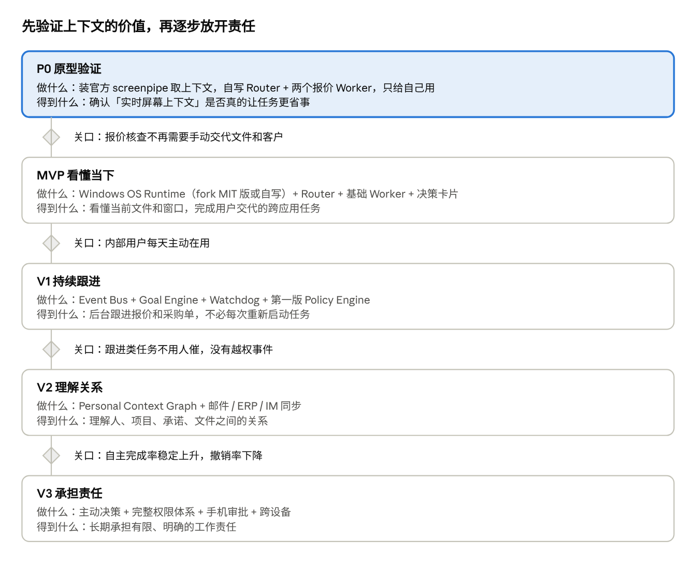

# Continuum 项目大纲

2026-11-02 · Yuxiang Lin

## 定位

Continuum（中文名「续」）是一个常驻在操作系统里的 AI 幕僚长：它看得到你此刻在做什么，记得过去发生了什么，并能替你长期负责一部分工作。

名字取自一句话：**用户切换的是软件，AI 维护的是同一个连续的工作世界。** 你在 Excel、邮件、浏览器、ERP 之间来回切，Continuum 的上下文、任务状态和执行能力始终跟着你，不会断。

技术上，它由三根支柱组成，外加一层贯穿全局的权限：

- **Super-agent（大脑）**：判断、规划、调度多个 Worker，长期推进目标。
- **OS Runtime（感官和双手）**：感知电脑上正在发生的事，在授权范围内执行操作。
- **Memory（长期记忆）**：知道你是谁、在做什么、为什么这么做、过去发生过什么。
- **Policy（权限与审计）**：不是第四根支柱，而是三者共用的地基。

## 要解决的问题

今天的 Agent 能干活，但还不能「替你负责」。卡在四个地方：

1. **每次都要重新交代上下文。** 用户得告诉 AI 文件在哪、客户是谁、第几版报价。云端 Agent 看不到你本机正在打开的东西。
2. **只会做一次性任务。** 「检查邮箱」能做，「跟进这个采购单直到交付」做不到。长期目标放在模型上下文里，几天就丢。
3. **记忆是聊天摘要，不是理解。** 它知道你喜欢什么，但不知道这个客户属于哪个项目、上次承诺了什么、哪个问题还没解决。
4. **不敢放手。** 外发邮件、改报价、下采购单没有清晰的权限边界和审计，用户只能每一步都盯着。

Continuum 的对应解法：OS Runtime 提供实时上下文，Goal Engine 持有长期责任，Context Graph 提供历史上下文，Policy Engine 让用户敢于授权。

## 目标用户与切入场景

先不做通用助理，从制造业的 BOM 报价与采购跟进切入，跑通闭环后再扩到其他知识工作。

**第一批用户**：电子制造企业里的报价、采购、销售工程师。他们每天在 Excel BOM、供应商邮件、分销商网站、ERP 之间来回切换，工作天然是跨软件、长周期、事件驱动的。

**为什么选这个场景**：

- **上下文在桌面上**：BOM 在本地 Excel、报价在邮件附件，云端 Agent 拿不到，正好体现 OS Runtime 的价值。
- **责任是长期的**：一个报价从 RFQ 到合同要几周，中间有价格变化、交期变化、客户追问，正好验证 Goal Engine。
- **结果可衡量**：报价异常抓到几项、跟进漏了几个、人工花了多少时间，都能数。
- **有行业积累**：可以直接复用现有的制造业 Agent 能力（BOM 解析、寻源、库存、RFQ）。

待确认：第一批是内部同事自用，还是直接找外部客户试点。

## 目标与非目标

核心目标是让用户敢把一件真实的工作责任交出去，并且不用每天回来检查。

**目标**

1. **零交代上下文**：用户只说「帮我看看这个报价」，系统自己认出是哪个文件、哪个客户、哪个版本。
2. **长期负责**：用户交代一个目标和边界，系统自己拆解、监听变化、安排后续行动，知道什么时候该停下来问人。
3. **可信的自主**：每个动作都有证据、权限范围和审计记录，能撤销的尽量支持撤销。
4. **安静**：平时隐形，只在需要决策时出现；出现时给决策卡片，不给大段文字。

**非目标**

- 不重写操作系统，不动内核；OS Runtime 是用户态的服务。
- 不做通用聊天机器人，不和 ChatGPT 比闲聊。
- 不追求手机上的完全控制；手机只做通知、审批、语音。
- 不自己训练基座模型。
- 第一阶段不做付款、签合同这类不可逆动作的自动执行。

**北极星指标：自主完成率**

```latex
\text{Autonomy Rate} = \frac{\text{无需额外人工干预就成功完成的授权任务}}{\text{全部授权任务}}
```

必须同时监控护栏指标，否则这个数字会鼓励危险的自主行为：错误率、越权尝试率、用户撤销率、每天打扰次数、每个任务的模型成本。

## 相似项目与差异化

这个方向已经很挤：2026 年 9～10 月三家大厂都发了常驻型个人 Agent，但它们都跑在云端虚拟机里，刻意和用户本机隔开。Continuum 的空间在**本机 OS 上下文 + 垂直领域的长期责任**。

| 项目 | 形态 | 和 Continuum 的重合 | 它没做的 |
| --- | --- | --- | --- |
| [OpenAI ChatGPT Dots](https://siliconangle.com/2026/09/29/openai-launches-dots-always-on-ai-agents-in-chatgpt-with-their-own-cloud-computers/)（2026-09-29） | 每个 agent 一台云电脑，常驻、主动汇报 | 长期记忆、后台并行、主动性 | 默认与本机登录环境隔离；通用，不懂行业 |
| [Meta Muse](https://about.fb.com/news/2026/09/introducing-muse)（2026-09-08） | 每人一台云端 Linux 虚拟机 | 后台持续执行 | 权限粗，曝出过越权事件 |
| [Anthropic Claude Duet](https://letsdatascience.com/news/anthropic-opens-claude-duet-research-preview-for-proactive-a-16522f5d)（2026-10-21 预览） | 主动 agent，晨报，不可逆操作先问 | 审批检查点、晨报 | 只看已连接应用，没有本机上下文 |
| DeepSeek Super-agent（2026-10-31） | Router/Worker 双层、事件驱动、Watchdog | 就是 Continuum 的大脑设计 | 原型只针对 GitHub 仓库；长期记忆、权限是开放问题 |
| [OpenClaw](https://clawdocs.org/architecture/overview) | 开源，常驻 Gateway + Heartbeat + Markdown 记忆 | 定时自醒、多渠道 | 记忆简单，权限宽 |
| [Hermes Agent](https://pypi.org/project/hermes-agent) | 开源，从经验中自己写 skill | 技能记忆、用户建模 | 同样权限宽 |
| [screenpipe](https://github.com/screenpipe/screenpipe) | 本机录屏 + 无障碍树 + 本地检索 | OS 感知层几乎一样 | 没有调度大脑、目标引擎、桌面执行；2026-06 起改为商业许可 |

**差异化一句话**：大厂做的是「云端替你上网办事」，Continuum 做的是「坐在你电脑旁边、懂你行业、替你盯住一件事直到完成」。

## 整体架构

Super-agent 是云端控制面，OS Runtime 是设备侧的感知与执行层，Memory 和 Goal Engine 回答两个长期问题：「这个人是谁、在做什么」和「哪些事还没真正完成」。



系统按一个闭环持续运转：OS 感知事件 → Event Bus 归到目标 → Router 结合 Memory 和 Goal Engine 判断、派 Worker 执行 → 结果写回 Memory，等下一个事件。每一个对外动作都要先从 Policy Engine 领到许可。

## 核心模块设计

六个模块里，Goal Engine 和 Policy Engine 是大厂和 DeepSeek 都没做透的部分，也是 Continuum 最该投入的地方。

### 1. OS Runtime（设备侧）

- **形态**：用户态常驻服务 + 桌面浮窗，先做 Windows，再做 macOS。手机只做通知、审批、语音。
- **感知**：按事件采集（切应用、切窗口、停止打字、剪贴板、文件变动、空闲兜底），不按固定帧率。截图和无障碍树同时取，文字优先用无障碍树，OCR 只兜底。浏览器靠扩展拿 URL 和 DOM。
- **执行顺序**：官方 API / MCP 优先，其次 UIA（Windows）/ AX（macOS）结构化控件，最后才是视觉 + 键鼠。
- **隐私**：本地先过滤和脱敏，只把必要的上下文传上云。无痕窗口默认不录、密码框跳过、应用黑白名单。
- **本地缓存**：SQLite + FTS5，参考 screenpipe 的 frames / elements / ui_events 三张表。

### 2. Event Bus

- 把 OS 事件、邮件/IM/ERP 的 webhook、定时 Heartbeat 统一成同一种事件格式。
- 两级过滤：先用规则筛掉大部分，再用便宜模型判断「这件事和哪个目标有关」。这一步决定成本，也决定会不会打扰太多。

### 3. Router / Worker / Watchdog（云端控制面）

- **Router**：常驻，只负责分派和协调，不干具体活。新事件来了，判断是唤醒已有任务还是新开 Worker。
- **Worker**：每个任务一个隔离沙箱，只拿自己需要的上下文和权限。类型：BOM 解析、寻源报价、文档生成、沟通起草、桌面操作。
- **Watchdog**：独立进程，不仅查进程活着没有，还判断 Worker 是在推进还是在空转。

### 4. Goal Engine

- 责任存在数据库里：目标、子任务、依赖、完成条件、截止时间、下次触发条件。关键流程用确定性状态机管。
- **模型负责理解和决策，不当事实来源。**
- 对账规则（借鉴 screenpipe 的 Living Commitments）：条目 ID 稳定；用户操作优先于模型判断；没有证据不能标「完成」，只能标「待复核」。
- 并发改同一张报价单或采购单时加锁、走事务。

### 5. Memory

- **Personal Context Graph**：人、公司、项目、承诺、文件、决策及其关系，每条带时间、来源、置信度，参考 Graphiti 的时间图谱。
- **事件日志**：发生过什么，只追加不修改。
- **事实和偏好**：可纠错、可追溯来源。
- **技能**：做过的流程存成 SKILL.md，用一次改进一次。
- 检索：图谱 + 向量 + 全文三路合并。每个 Worker 做完写回，每晚整理一次（合并、处理矛盾、过期）。

### 6. Policy Engine（贯穿所有层）

- **Router 只能申请权限，不能自己批。** 每个任务领一个能力令牌，写明能碰哪些应用、文件、系统。
- 风险分四档：只读自动；可撤销的写做完通知；对外发送要审批；付款、删除、改生产数据二次确认。
- 从邮件、网页、屏幕读入的内容一律标「不可信」，带此标记的上下文不能直接触发高风险动作，用来防 prompt 注入。
- 所有动作入审计日志，可撤销的记录撤销方法。

## 端到端场景：Excel BOM 报价核查

用户只说一句话，系统就能认出上下文、并行核查、等审批，并在之后一直盯着这份报价。

1. **感知**：用户在 Excel 里打开「Laser Control Board BOM」，旁边是供应商的最新报价邮件。OS Runtime 记下当前窗口、文件路径、关联邮件。
2. **一句话**：用户说「帮我检查一下这个报价有没有问题」，不用说文件在哪、客户是谁。
3. **关联**：Router 从 Context Graph 查到这份 BOM 属于哪个客户、哪个报价目标、上一版报价是多少。
4. **并行核查**：Router 开四个 Worker，各自领只读权限：
    - A：检查 MPN、描述、数量。
    - B：核实供应商价格、MOQ、交期。
    - C：和历史报价对比找异常。
    - D：生成修订版 Excel 和报告（写在新文件里，不动原件）。
5. **决策卡片**：「发现 4 项报价异常，已生成修订文件。是否更新正式报价？」改正式报价属于「写生产数据」，Policy Engine 要求审批。
6. **写回和持续跟进**：结果写进 Memory；Goal Engine 给这份报价登记「等客户回复」「供应商价格变化时重算」两个触发条件。几天后供应商来信涨价，Event Bus 把它对到这个目标上，自动重新跑一遍。

关键在于：**OS Runtime 提供实时上下文，Memory 提供历史上下文，Super-agent 把它们变成行动，Goal Engine 让这件事不会做完一次就忘。**

## 技术选型与可复用资产

大部分组件都有现成的起点，需要从零做的主要是 Goal Engine、Policy Engine 和桌面执行层。以下为建议，待定。

| 模块 | 建议选型 | 可复用资产 | 注意 |
| --- | --- | --- | --- |
| OS Runtime 感知 | Rust 常驻服务：Windows 用 UIA + WGC 截屏 + 系统钩子 | screenpipe `app-v2.5.27`（最后一个 MIT 版本）的 capture / a11y / screen / db crate | 2026-06-10 之后的版本是商业许可，不能用；`ee/` 目录也不能用 |
| OS Runtime 执行 | UIA 操作 + 浏览器扩展；键鼠只兜底 | 无，需自建 | screenpipe 没有桌面执行能力 |
| 桌面外壳 | Electron 或 Tauri | ATRI 桌面端（Electron，已有发版和 Windows CI） | 工作助理和桌宠是不同产品，只复用工程部分 |
| Router / Worker | Python 服务，Worker 跑在沙箱里 | OManus 的沙箱、多租户、worker；DeepSeek Super-agent 开源原型的调度设计 | DeepSeek 原型只针对 GitHub 仓库，只借鉴设计 |
| Event Bus | Redis Streams 起步，量大再换 NATS | — | — |
| Goal Engine | PostgreSQL + 状态机 | screenpipe 的 commitments 对账规则（只借鉴思路） | 事实来源在数据库，不在模型上下文 |
| Memory | 先 PostgreSQL + pgvector + 全文，图谱需求明确后引入 Graphiti | [Graphiti](https://www.developersdigest.tech/blog/best-ai-agent-memory-providers-2026)（Apache-2.0）、ATRI 的记忆与夜间整理 | Graphiti 要自己维护图数据库 |
| 连接器 | MCP | 制造业现有 Worker：BOM 解析、寻源、库存、RFQ、ERP | — |
| 模型 | 便宜模型做事件过滤和 Router，强模型做 Worker | DeepSeek 系列（已有密钥和接入经验） | 按任务记录成本 |

**screenpipe 的用法**：原型阶段可以直接装官方版，通过 MCP / HTTP 读数据验证体验（仅限个人使用）；正式产品只从 MIT 版本拆采集相关 crate，或只借鉴设计自己写。fork 前请法务确认。

## 路线图

先花最少的力气验证「实时上下文」是否值钱，再一步步加上长期跟进、关系理解和主动决策。每个阶段只有过了关口才进入下一阶段。



各阶段的周期和关口的具体数字待定，建议在 P0 结束时根据实测再定。

## 风险与待决问题

最大的风险不在模型能力，而在信任和隐私：持续感知电脑屏幕让价值和风险同时变大。

**风险**

- **隐私与企业合规**：持续采集屏幕会碰到客户数据和员工隐私。对策：本地优先、可见的采集指示、应用黑白名单、脱敏后再上云。
- **Prompt 注入**：邮件、网页、屏幕里的恶意指令可能驱动 Agent。对策：不可信标记 + 能力令牌 + 高风险动作审批。
- **桌面执行不稳**：界面一改就失败。对策：API 优先，UIA 次之，键鼠最后。
- **成本**：常驻监听 + 并行 Worker 会快速烧 token。DeepSeek 自己的实验里，Super-agent 的缓存读取 token 约为对照组的 3.8 倍。对策：规则前置过滤、便宜模型分流、按任务记账。
- **大厂下场**：Dots / Duet 可能很快加上本机接入。对策：靠行业深度和可私有部署拉开差距。
- **许可证**：screenpipe 只能用 MIT 旧版或只借鉴设计。

**待决问题**

- [ ] Continuum 是独立仓库，还是和 ATRI 共用 OManus 底座？
- [ ] 第一批用户是内部自用还是外部客户试点？
- [ ] 部署形态：SaaS，还是企业私有部署优先？
- [ ] OS Runtime 是 fork screenpipe MIT 版本，还是自己写？
- [ ] 默认采集什么、存多久、什么内容可以上云？
